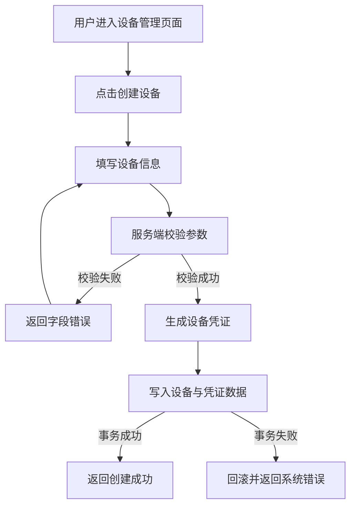

# 示例：设备管理模块详细功能设计

本示例用于展示通用详细设计应达到的具体粒度。它改编自“星枢 IoT 平台”的设备管理场景，所有角色、编号、字段、接口、数值、文案和规则均为示例数据，不能直接当作其他项目的事实。

## 文档属性

| 属性 | 内容 |
| --- | --- |
| 文档编号 | FDD-DEVICE-001 |
| 文档版本 | V1.0 |
| 所属系统 | IoT 平台（ IoT） |
| 所属模块 | 设备管理 |
| 文档状态 | 已完成设计（示例） |
| 编写日期 | 2026-11-23 |
| 关联需求 | PRD-DEVICE-001 |
| 适用人员 | 产品、前端、后端、测试、运维 |

## 1. 文档概述

### 1.1 设计目的

本设计用于详细描述设备管理模块的能力、交互、业务规则、数据结构、接口、权限、异常和验收标准，为实现和验证提供统一依据。

### 1.2 功能范围

| 功能编号 | 功能名称 | 功能说明 |
| --- | --- | --- |
| DEV-001 | 设备列表 | 查询、筛选、分页展示设备 |
| DEV-002 | 创建设备 | 手动创建设备 |
| DEV-003 | 编辑设备 | 修改设备基础信息 |
| DEV-004 | 删除设备 | 删除指定设备 |
| DEV-005 | 设备详情 | 查看设备详细信息 |
| DEV-006 | 设备启停 | 启用或禁用设备 |
| DEV-007 | 设备凭证 | 查看、生成和重置设备凭证 |

### 1.3 角色权限

| 角色 | 查询 | 创建 | 编辑 | 删除 | 启停 |
| --- | --- | --- | --- | --- | --- |
| 平台管理员 | √ | √ | √ | √ | √ |
| 租户管理员 | √ | √ | √ | √ | √ |
| 普通用户 | √ | × | × | × | × |
| 只读用户 | √ | × | × | × | × |

权限需要结合租户数据范围进一步判断，不能仅根据角色名称决定是否可访问设备。

## 2. 业务流程设计

### 2.1 创建设备业务流程



### 2.2 业务规则

1. `[来源]` 每台设备必须归属于一个租户。
2. `[来源]` 设备名称在同一租户内不能重复；是否允许不同租户重名由租户隔离规则决定。
3. `[来源]` 设备标识必须全局唯一。
4. `[来源]` 设备必须关联一个产品。
5. `[建议]` 创建设备时自动生成设备凭证；凭证明文只在创建成功响应中返回一次。
6. `[待确认]` 删除设备前是否必须检查未解除的关联关系，影响删除接口和异常提示。
7. `[来源]` 禁用设备后，设备不能继续进行正常业务接入。

## 3. 页面功能设计

### 3.1 设备列表页面

**入口**：用户从系统导航进入“设备管理”。无设备查询权限时显示无权访问提示，不请求设备数据。

**页面布局**：

```text
设备管理                                                   [页面状态]
设备名称/设备标识 [输入框]    状态 [下拉]    [查询] [重置]
共 128 台设备                                      [+ 创建设备]
----------------------------------------------------------------
设备名称          设备标识       产品       状态       操作
温度传感器-001    SN20260001     温度传感器   在线       详情 编辑
智能网关-002      SN20260002     智能网关     离线       详情 编辑
水位传感器-003    SN20260003     水位传感器   禁用       详情 编辑
----------------------------------------------------------------
分页
```

**字段与行为**：

| 区域 | 组件/字段 | 行为 |
| --- | --- | --- |
| 查询区 | 设备名称/标识 | 支持包含匹配；点击查询回到第 1 页 |
| 查询区 | 状态 | 可选在线、离线、禁用、未激活 |
| 查询区 | 重置 | 清空条件并加载第 1 页 |
| 工具栏 | 创建设备 | 有创建权限时可用，否则隐藏或禁用并说明原因 |
| 表格 | 设备名称、标识、产品、状态 | 按设备创建时间倒序展示 |
| 操作列 | 详情、编辑 | 按权限显示；编辑保存后保留当前筛选和分页 |

**列表状态**：首次加载显示加载状态；无数据显示“暂无设备”；无搜索结果显示“没有匹配的设备”；请求失败保留筛选条件并显示重试；删除当前页最后一条记录后，非第 1 页时回到上一页。

### 3.2 创建设备页面

**页面类型**：抽屉式表单。

| 字段名称 | 字段标识 | 类型 | 必填 | 校验规则 |
| --- | --- | --- | --- | --- |
| 设备名称 | deviceName | String | 是 | 1–64 字符；同租户内唯一 |
| 设备标识 | deviceCode | String | 否 | 未填写时自动生成；填写时必须全局唯一 |
| 所属产品 | productId | Select | 是 | 必须选择有效产品 |
| 所属网关 | gatewayId | Select | 否 | 必须是当前租户可用网关 |
| 设备描述 | description | String | 否 | 最多 500 字符 |
| 设备标签 | tags | Array | 否 | 最多 20 个 |

**交互流程**：

1. 点击“创建设备”打开抽屉，焦点落在设备名称。
2. 系统加载当前用户可用产品和网关；加载失败时保留已填写内容并允许重试。
3. 点击保存时先执行前端校验，再提交服务端校验。
4. 校验失败时保留输入，聚焦首个错误字段并显示字段级提示。
5. 校验通过后显示提交中并禁用保存按钮，防止重复提交。
6. 成功后关闭抽屉，提示“设备创建成功”，按原筛选重新加载设备列表。
7. 失败时保留输入，恢复保存按钮并显示可重试错误；服务端字段错误映射到对应字段。
8. 关闭有未保存更改的抽屉时，显示“放弃未保存的更改？”；继续编辑保留输入，放弃则关闭并丢弃输入。

### 3.3 设备详情与启停

详情页展示设备基础信息、当前状态、最近通信时间、关联产品、关联网关、标签、创建/修改记录和凭证操作。状态变更必须显示操作者、时间和结果。

启用或禁用设备前显示确认信息；提交中禁用重复操作。成功后刷新状态和操作按钮；失败时保留原状态并提供重试。设备在线状态和管理启用状态分开保存，避免把“在线”误当作“已启用”。

## 4. 接口设计

### 4.1 创建设备接口

| 属性 | 内容 |
| --- | --- |
| 接口名称 | 创建设备 |
| 请求地址 | `/api/device/create` |
| 请求方式 | `POST` |
| Content-Type | `application/json` |
| 权限标识 | `device:create` |
| 幂等要求 | 使用请求幂等键，重复提交不得创建重复设备 |

**请求参数**：

```json
{
  "deviceName": "温度传感器-001",
  "deviceCode": "SN20260001",
  "productId": 10001,
  "gatewayId": null,
  "description": "一楼机房温度传感器",
  "tags": ["温度", "一楼"]
}
```

**成功响应**：

```json
{
  "code": 200,
  "message": "创建成功",
  "data": {
    "deviceId": 20001,
    "deviceName": "温度传感器-001",
    "deviceCode": "SN20260001",
    "status": "INACTIVE",
    "credential": "仅返回一次的设备凭证"
  }
}
```

### 4.2 接口业务处理顺序

1. 获取当前登录用户身份和租户范围。
2. 校验用户具有 `device:create` 权限。
3. 校验产品、网关是否在当前用户可用范围内。
4. 校验设备名称和设备标识唯一性。
5. 生成设备 ID 和设备认证凭证。
6. 在同一事务中写入设备、凭证和审计记录。
7. 提交事务并返回创建结果。
8. 凭证生成或持久化失败时回滚设备数据，不返回部分成功。

### 4.3 异常响应

| 错误编码 | 错误描述 | 处理方式 |
| --- | --- | --- |
| DEVICE_001 | 设备名称不能为空 | 返回参数错误并定位字段 |
| DEVICE_002 | 设备名称已存在 | 提示修改名称 |
| DEVICE_003 | 设备标识已存在 | 提示修改标识 |
| DEVICE_004 | 产品不存在或不可用 | 提示重新选择产品 |
| DEVICE_005 | 无设备创建权限 | 拒绝请求并记录审计 |
| DEVICE_006 | 设备创建失败 | 回滚事务并允许重试 |

## 5. 数据库设计

### 5.1 设备表 `iot_device`

| 字段 | 类型 | 约束/说明 |
| --- | --- | --- |
| id | BIGINT | 主键 |
| tenant_id | BIGINT | 租户 ID，非空 |
| product_id | BIGINT | 产品 ID，非空 |
| device_name | VARCHAR(64) | 设备名称 |
| device_code | VARCHAR(64) | 设备标识，全局唯一 |
| device_type | VARCHAR(32) | 设备类型 |
| gateway_id | BIGINT | 所属网关，可为空 |
| status | VARCHAR(20) | 管理状态 |
| online_status | VARCHAR(20) | 在线状态 |
| description | VARCHAR(500) | 设备描述 |
| create_by | BIGINT | 创建人 |
| create_time | DATETIME | 创建时间 |
| update_by | BIGINT | 修改人 |
| update_time | DATETIME | 修改时间 |
| deleted | TINYINT | 逻辑删除标识 |

### 5.2 数据约束

1. `[来源]` `id` 为主键。
2. `[来源]` `device_code` 建立全局唯一约束。
3. `[来源]` `tenant_id` 建立普通索引，用于租户范围查询。
4. `[来源]` `product_id` 建立普通索引。
5. `[建议]` `tenant_id + device_name + deleted` 建立联合唯一约束；最终方案需结合逻辑删除实现确认。
6. 设备凭证单独存储，数据库中只保存不可逆摘要或加密密文。

### 5.3 状态定义

| 状态 | 编码 | 说明 |
| --- | --- | --- |
| 未激活 | INACTIVE | 已创建但未完成首次接入 |
| 在线 | ONLINE | 最近心跳在有效窗口内 |
| 离线 | OFFLINE | 最近心跳超出有效窗口 |
| 禁用 | DISABLED | 管理员主动禁用 |

在线/离线属于运行状态，启用/禁用属于管理状态；实际存储和展示不能混为一个字段。

## 6. 权限与安全设计

### 6.1 权限控制

| 操作 | 权限编码 | 控制位置 |
| --- | --- | --- |
| 查询设备 | `device:list` | 后端接口、数据范围 |
| 创建设备 | `device:create` | 后端接口 |
| 编辑设备 | `device:update` | 后端接口 |
| 删除设备 | `device:delete` | 后端接口 |
| 查看详情 | `device:detail` | 后端接口 |
| 重置凭证 | `device:credential:reset` | 后端接口、二次确认 |

### 6.2 数据安全

- 所有设备操作按租户和数据范围隔离。
- 禁止通过修改 `tenantId` 越权访问其他租户设备。
- 凭证只在创建或重置成功时明文展示一次。
- 所有创建、编辑、删除、启停和凭证操作写入审计日志。
- 删除采用逻辑删除；关联数据和审计记录的保留策略需按合规要求确认。

## 7. 异常处理设计

| 异常场景 | 系统处理 | 前端/调用方反馈 |
| --- | --- | --- |
| 网络请求失败 | 不写入或回滚数据 | “网络异常，请重试” |
| 参数校验失败 | 拒绝请求 | 显示具体字段错误 |
| 产品已删除 | 拒绝创建 | “产品不可用，请重新选择” |
| 用户无权限 | 拒绝请求并记录日志 | “无权执行此操作” |
| 设备标识冲突 | 唯一约束拦截 | “设备标识已存在” |
| 数据库异常 | 回滚事务 | “操作失败，请稍后重试” |
| 重复提交 | 幂等返回首次结果 | 不产生重复设备 |
| 凭证生成失败 | 回滚设备和凭证 | 保留表单并允许重试 |

## 8. 验证与测试衔接

本节只说明验证范围，不替代正式测试用例。正式用例应由 `test-case-workflow` 根据本设计的编号生成。

| 覆盖类别 | 验证重点 | 设计编号 |
| --- | --- | --- |
| 正常流程 | 创建设备、编辑、删除、启停成功 | DEV-002–DEV-006 |
| 边界输入 | 名称长度、描述长度、标签数量 | RULE-001–RULE-003 |
| 权限 | 普通用户创建、越权租户访问 | SEC-001–SEC-003 |
| 状态 | 未激活、在线、离线、禁用转换 | STATE-001–STATE-004 |
| 异常 | 唯一冲突、依赖不可用、事务回滚 | ERR-001–ERR-008 |
| 并发/幂等 | 重复点击、重复请求、同时编辑 | CON-001–CON-003 |

## 9. 验收标准

- 给定拥有创建权限的租户管理员，填写合法设备信息并提交，系统创建一条设备记录并返回一次性凭证。
- 给定设备名称为空，提交后不写入数据，名称字段显示错误并获得焦点。
- 给定设备标识已存在，提交后拒绝创建，保留用户输入并提示修改设备标识。
- 给定普通用户访问创建设备入口，系统不允许创建且不泄露其他租户设备数据。
- 给定凭证生成失败，设备和凭证数据均不保留，用户可以在原表单上重试。
- 给定当前页只有一条设备且当前不是第 1 页，删除成功后列表跳转到上一页并保留筛选条件。
- 给定重复提交同一幂等请求，系统最多创建一台设备并返回一致结果。
- 给定设备被禁用，设备不能继续进行正常业务接入，页面显示禁用状态和操作结果。

## 10. 需求追踪关系

| 需求编号 | 功能编号 | 规则/接口编号 | 验收编号 |
| --- | --- | --- | --- |
| REQ-DEVICE-001 | DEV-002 | API-DEVICE-001、RULE-001 | AC-DEV-001–003 |
| REQ-DEVICE-002 | DEV-003 | API-DEVICE-002 | AC-DEV-004 |
| REQ-DEVICE-003 | DEV-004 | API-DEVICE-003、RULE-006 | AC-DEV-005 |
| REQ-DEVICE-004 | DEV-006 | API-DEVICE-004、STATE-004 | AC-DEV-006 |

测试用例编号由 `test-case-workflow` 生成后回填；设计文档保留本表作为稳定追踪源。

## 11. 假设与待确认项

| 编号 | 待确认内容 | 推荐方案 | 影响 |
| --- | --- | --- | --- |
| TBD-001 | 删除设备时是否检查关联关系 | 检查并返回可修复的冲突提示 | 影响删除接口和数据清理 |
| TBD-002 | 设备标识唯一范围 | 全局唯一 | 影响数据库约束和接入协议 |
| TBD-003 | 凭证保存方式 | 加密保存或只保存摘要 | 影响凭证重置和运维取证 |
| TBD-004 | 在线判定时间窗口 | 由设备类型配置 | 影响状态任务和列表展示 |

以上待确认项确认前不得当作项目既定规则；实现和正式测试应引用确认后的版本。


